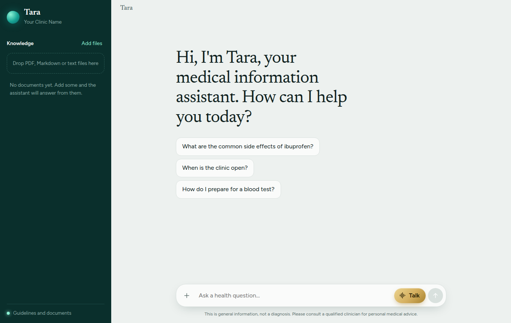
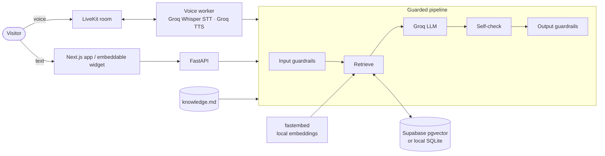
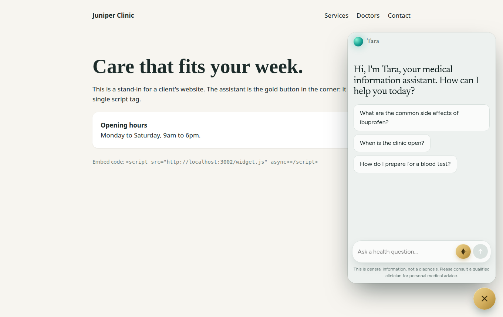

<h1 align="center">Voice AI</h1>

<p align="center">
  A voice and chat assistant that answers from your own documents, stays inside its subject,<br>
  and retargets to a new industry by editing a single Markdown file.
</p>

<p align="center">
  
  
  
  
  
  
  
</p>

<p align="center">
  
</p>

## Contents
[Overview](#overview) · [Video walkthrough](#video-walkthrough) · [Features](#features) · [Architecture](#architecture) · [Quick start](#quick-start) · [Retarget to a new domain](#retarget-to-a-new-domain) · [Guardrails](#guardrails) · [Reliability](#reliability) · [Embed on a website](#embed-on-a-website) · [Project structure](#project-structure) · [Testing](#testing) · [Going to production](#going-to-production) · [Known limitations](#known-limitations)

## Overview
Most chatbots are built once for one business. This project separates **what the assistant is** from **how it works**:

- `knowledge/knowledge.md` defines the domain, persona, allowed topics, fixed refusal text, emergency rules and guidelines.
- The Python and TypeScript code is domain-agnostic. It handles speech, retrieval, guardrails and the UI.

The shipped configuration is a **medical information assistant**. Replace one file and a folder of documents, and the same code serves a law firm, a dental practice or a support desk.

## Video walkthrough
> 🎬 **Coming soon.** A full walkthrough of the voice mode, document upload and website embed will be added here.

<!-- Replace this block with the video link or an embedded thumbnail once it is recorded. -->

## Features
| | |
|---|---|
| **Voice and chat** | Talk to the assistant in a ChatGPT-style voice mode with a live orb that reacts to speech, or type. Both share one pipeline and one conversation memory. |
| **Retrieval from your documents** | Upload PDF, Markdown or text files from the UI. They are semantically chunked, embedded locally and searched at answer time, with sources cited. |
| **Structured answers** | Every reply carries a summary, key points, next steps and sources. Voice speaks a short natural version of the same answer. |
| **Three knowledge modes** | `prompt` (guidelines only, GPT-wrapper style), `rag` (documents only) or `hybrid`. Switch with one line of config. |
| **Layered guardrails** | Prompt-injection screening, PII redaction, emergency routing, scope enforcement and output leak checks, all enforced in code. |
| **Self-healing** | Model fallback, retries with backoff, graceful degraded modes and a health endpoint. |
| **Embeddable** | One script tag adds a floating voice and chat widget to any website. |

## Architecture


The voice worker only handles audio. Every reply, spoken or typed, comes from the same `pipeline.answer()` function, so voice gets identical guardrails, retrieval and memory.

| Concern | Choice |
|---|---|
| LLM | Groq `openai/gpt-oss-120b`, falling back to `gpt-oss-20b` |
| Speech to text | Groq Whisper (`whisper-large-v3-turbo`) |
| Text to speech | Groq Orpheus, with browser speech as a fallback |
| Embeddings | `BAAI/bge-small-en-v1.5` via fastembed, running locally with no API key |
| Vector store | Supabase pgvector, or a local SQLite file when Supabase is not configured |
| Realtime audio | LiveKit Agents |

## Quick start
**Requirements:** Python 3.10+, [uv](https://docs.astral.sh/uv/), Node 20+, pnpm, and free accounts at [Groq](https://console.groq.com) and [LiveKit Cloud](https://cloud.livekit.io).

```bash
git clone https://github.com/PranavTJ-05/tara-ai.git && cd tara-ai

# 1. Backend
cd backend
cp .env.example .env          # add your keys (see the table below)
uv sync

# 2. Frontend
cd ../frontend
cp .env.local.example .env.local
pnpm install
```

Run three processes:

```bash
cd backend  && uv run uvicorn app.api:app --port 8000     # API
cd backend  && uv run python -m app.agent dev             # voice worker
cd frontend && pnpm dev                                   # UI at http://localhost:3000
```

If the UI runs on a different port, add that origin to `ALLOWED_ORIGINS` in `backend/.env`.

| Variable | Purpose |
|---|---|
| `GROQ_API_KEY` | LLM, speech to text and text to speech |
| `LIVEKIT_URL`, `LIVEKIT_API_KEY`, `LIVEKIT_API_SECRET` | Voice rooms |
| `SUPABASE_URL`, `SUPABASE_SERVICE_KEY` | Optional. Without them a local SQLite file is used |
| `ALLOWED_ORIGINS` | Comma-separated origins allowed to call the API |

**Optional, for Supabase:** run `backend/supabase/schema.sql` once in the Supabase SQL editor.

**Voice replies:** Groq's Orpheus voice requires a one-time terms acceptance by the Groq organisation admin at
[console.groq.com/playground?model=canopylabs/orpheus-v1-english](https://console.groq.com/playground?model=canopylabs%2Forpheus-v1-english).
Until that is done, the worker detects it and the browser reads replies aloud with its built-in voice.

## Retarget to a new domain
Edit **`knowledge/knowledge.md`**. The front matter controls behaviour; the body holds your guidelines.

```yaml
---
domain: legal                        # defines what "in scope" means
assistant_name: Lex
organization: Hartley & Moss LLP
mode: hybrid                         # prompt | rag | hybrid
allowed_topics:
  - practice areas and services
  - how to book a consultation
refusal_message: "That's outside what I can help with. I can answer questions about our services."
emergency_keywords: []               # optional, matched as whole phrases
starter_questions:
  - What areas of law do you cover?
---
# Assistant guidelines
...your firm's rules and details...
```

Then add the firm's documents from the sidebar (or drop them in `knowledge/docs/`). No code changes are needed.

## Guardrails
Every layer is enforced in code, so a clever prompt cannot talk the assistant out of them.

1. **Input gate.** Length cap, Unicode normalisation (defeats zero-width and full-width evasion), injection patterns, emergency phrases, and PII redaction (email, phone, SSN, Luhn-validated cards, Aadhaar, date of birth, record numbers) *before* the model or memory sees the text.
2. **Prompt.** A strict scope, plus the rule that user text, history and retrieved documents are data, never instructions. A canary token detects prompt leaks.
3. **Model output.** Structured fields `in_scope`, `injection_attempt` and `grounded` are checked by the pipeline.
4. **Output gate.** Off-topic requests receive the fixed refusal from `knowledge.md` (the model's own text is discarded), leaks are blocked, and PII is redacted. Only the operator's own contact details may pass.
5. **Memory hygiene.** Refusals and blocked inputs are never saved to conversation memory.

The assistant stays conversational: greetings, thanks and light small talk get warm replies, while coding, homework, other professions and role-play requests are declined.

## Reliability
- **Model fallback.** If the primary model is rate-limited or down, the request retries and then moves to the fallback model.
- **Grounding check.** An answer that is not supported by the guidelines or documents gets one stricter retry, then a safe "I don't have that information" reply.
- **Graceful degradation.** A failed vector search falls back to guidelines only, a memory failure keeps the conversation going, and a total outage returns a clear message instead of an error.
- **Voice fallback.** If server-side speech is unavailable, the browser speaks the reply.
- **Health.** `GET /health` reports knowledge, key, store and LiveKit status.

## Embed on a website
Add one line before `</body>` on any site:

```html
<script src="https://YOUR-APP-HOST/widget.js" async></script>
```

A floating launcher opens the assistant in an iframe, so it cannot clash with the host page's CSS. Options: `data-position="left"` and `data-label="Ask our team"`. From JavaScript: `VoiceAI.open()` and `VoiceAI.close()`. Try it locally at `/demo.html`. The embedded view hides document management.

<p align="center">
  
</p>

## Project structure
```
knowledge/
  knowledge.md          The one file you edit to change domain and behaviour
  docs/                 Documents for retrieval (also managed from the UI)
backend/
  app/
    pipeline.py         Single entry point for chat and voice
    guardrails.py       Injection, PII, emergency and output checks
    prompts.py          System prompt template
    llm.py              Groq calls with model fallback
    retriever.py        Semantic retrieval
    rag/                Semantic chunker, local embeddings, vector stores
    ingest.py           Documents to chunks to embeddings to store
    agent.py            LiveKit voice worker
    api.py              FastAPI: chat, token, config, documents, health
  supabase/schema.sql
  tests/
frontend/
  components/           Chat, voice orb, sidebar, answer cards
  public/widget.js      Embeddable widget
research/               Notes behind the architecture decisions
```

## Testing
```bash
cd backend && uv run pytest        # 47 tests, no API keys required
cd frontend && pnpm exec tsc --noEmit && pnpm build
```
The backend suite covers the guardrails, chunking, the pipeline (with a mocked model), document upload rules and the local store.

## Going to production
This is a working prototype. Before putting it in front of a real client:

- [ ] Serve everything over **HTTPS**. Browsers block the microphone otherwise.
- [ ] Deploy the voice worker on an always-on host.
- [ ] Run `schema.sql` and configure Supabase.
- [ ] Set `EMBED_ANCESTORS` (frontend) to the client's domains and `ALLOWED_ORIGINS` (backend) to your app's origin.
- [ ] Put **authentication** in front of `/documents`. These endpoints are currently open.
- [ ] Add **rate limits and spend caps**. A public microphone can run up usage quickly.
- [ ] Accept the Groq Orpheus terms.
- [ ] For regulated domains such as healthcare or law, obtain the required agreements and a professional review. Guardrails reduce risk but do not replace compliance.

## Known limitations
- One deployment serves one `knowledge.md`. Multi-client hosting in a single deployment is not built.
- Groq's free tier is rate-limited, which can slow answers under load.
- Prompt-injection screening combines pattern checks with model signals. It lowers risk but is not a guarantee.
- Speech quality, latency and accent handling depend on the Groq models and have not been benchmarked here.

<p align="center">Built with ❤️ by <a href="https://github.com/PranavTJ-05">PranavTJ-05</a></p>
